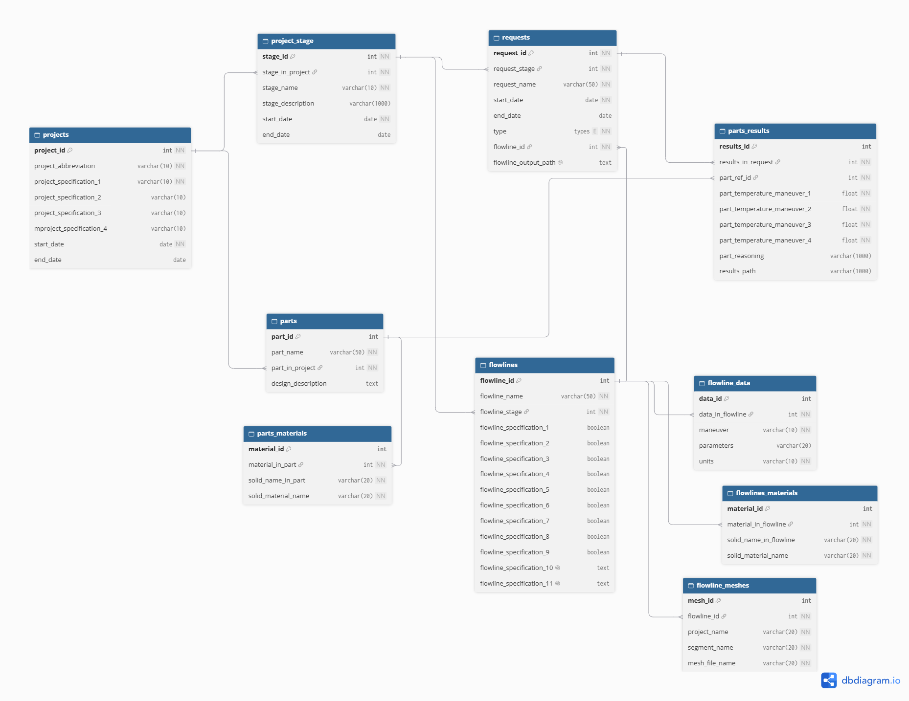

## TL;DR

- Consolidated 6–7 years of simulation data from cloud storage, local servers, tracking boards, and reference files into one relational MySQL database.
- Designed the schema from scratch and built a Python ETL pipeline that loads in parent-child order and links records across sources using two-step fuzzy matching.
- Added duplicate and change detection so repeated runs across different locations never double-loaded records.
- Search for data went from days of manual digging to minutes.

*Solo build, with team review · 2026 · Python, MySQL, Pandas, SQLAlchemy, fuzzy matching · Internal work; public rebuild linked below*

## The Problem: Years of valuable data nobody could search

Technical Analysts built simulation models, analyzed results, and prepared client reports. The data for each step lived in a disconnected place: cloud storage, local servers, online tracking boards. Unconnected locations meant duplication; the same model could be saved in two places with no way to trace the two copies to each other. Naming conventions were also inconsistent and unreliable. The work process was updated every year or two, and no standardization rules existed.

Two things followed:

1. Finding old data, or answers in old models, was a long manual search that sometimes outright failed.

2. The team had a valuable data treasury it couldn’t access—one that could have trained new members, fed prediction models, and given potential clients more insight.

## My Role & Constraints

I was the technical team leader, seven years into the firm. I had access to every model and storage location, and I carried the work memory; each era’s modelling specs, the updates made over the years, and the client's most frequent requests and issues that required digging into old records.

→ The project’s scope was not to rebuild the systems the team used or connect them, but to log all existing data in a tructured format and allow future data to be logged as well. I was working around the systems in use, not against them.

*The original system and its data are internal, so this case study covers the problem and methods, not the specific architecture or client outcomes. Snapshots and details are anonymized for confidentiality. The public rebuild is linked below.*

## How I built it: Approach & key decisions

### Schema Design

I started by producing a list of questions and requirements the database needed to satisfy, then ran it by the team and edited it based on their feedback, and designed the schema based on it. 

The database had to:
- Satisfy each requirement on the list.
- Allow seamless future improvements and additions without needing a rebuild.

That requirements list, alongside domain knowledge and normalization rules, drove the tables and entities, the columns inside each, and the relationships between them. I tested the design with mock runs simulating the team’s usage and checked every requirement was met. 

The initial design was fully normalized for efficiency and easy future additions, with limited denormalization introduced later to make the database easier to use. I started with eight tables, with a top-level parent table (*projects*) from which connections flowed to the rest of the tables. I later added two additional tables mid-development (*flowlines_meshes & flowlines_materials*) to solve duplication issues, as explained below.

### The ETL flow

I wanted the ETL flow to run as a continuous process through Python scripts. Since the data was scattered across several locations, it would run in stages—newest locations first, older ones after. The scripts had to run independently in the designed parent-child order across different locations, without duplication, and while keeping primary key–foreign key relationships intact.

→ How I set it up: Each run connects to the database, pulls relevant records for comparison and PK-FK connections, then pushes the new records back. 

I compared records using regex and fuzzy matching; in some cases, using a two-step approach; filter first, then apply token-based matching to find the best matches. That was essential to get over the lack of data standardization.

### Top level missing older models’ data

The data existed at three levels, with the project's metadata living at the top level. The work process also changed every year or two, and these regular updates meant that the top level sometimes lacked earlier years’ data.

Left unchecked, data could attach to the wrong parent when the correct parent data was missing. Automatic fuzzy matching alone wouldn’t fix this: it would return a low matching score but still proceed. And applying a score threshold wouldn’t work either: the lack of standardization meant fuzzy matching sometimes gave a low score to a correct match.

I had to rely on human input for this stage. I added a manual review checkpoint before any ingestion, where a separate script was run first in every data location, outputting a .csv file containing matches between projects in the current data location, and the projects already in the database. In cases of zero matches, the metadata had to be added to the database first before ingestion could continue.

### Preventing duplication

Data extracted from the simulation models populated two tables, *flowlines* and *parts*, plus their child tables. By design, models could contain similar *flowlines* and different *parts*. Avoiding duplicate flowline entries was crucial to maintaining the database’s original goals.

To avoid flowline duplications, I extracted metadata describing the flowlines and stored it in two newly added tables (*flowlines_meshes & flowlines_materials*). During ingestion, this metadata was compared against what was already in the database: if it was new, ingestion continued; if not, the model was skipped.

## What Changed

*The firm shut down in June 2026 with the project at 80% completion. I had, at the time, carried out limited data ingestion using data from different work eras as part of my ongoing testing. The following results were observed from that small data collection.*

- Search times for old data dropped drastically — from days of manual digging to minutes.
- It became possible to get an overview of any project from the top level down to the most detailed level quickly and easily.
- The previously inaccessible data treasury became queryable and usable for onboarding and analysis.

## What I’d do differently

1. Connect the scripts with a simple UI and impose running rules — no child scripts before parent scripts, and the metadata checkpoint script runs automatically before any other run, with a pause for approval.
2. Add a review step after each ETL in each script to confirm records loaded in the correct locations.
3. Add logging to trace bad ingestions back to source files and timestamps, ideally with a staging layer where data is reviewed before it enters the real database.

## Where it is now

When the firm shut down, eight of the ten tables were complete and operational; two, *flowline_data* and *parts_results*, were still under development.

After the closure, I chose not to finish those two tables. Instead, I built what the next phase would have needed: an automated ETL pipeline for future data, running from the moment files land in Azure Blob Storage to a final, ready-to-query database for the team. Case study coming soon.

I am currently writing the case study for that project. Meanwhile, check the repo on [GitHub](https://github.com/NohaKhaled01/EngineeringSimulationDataWarehouse_Azure_MySql)

<!-- I wrote this up as a separate case study: [Automating the simulation data pipeline on Azure](link). -->

## See the code

[View the public rebuild on GitHub](https://github.com/NohaKhaled01/EngineeringSimulationDataWarehouse)
