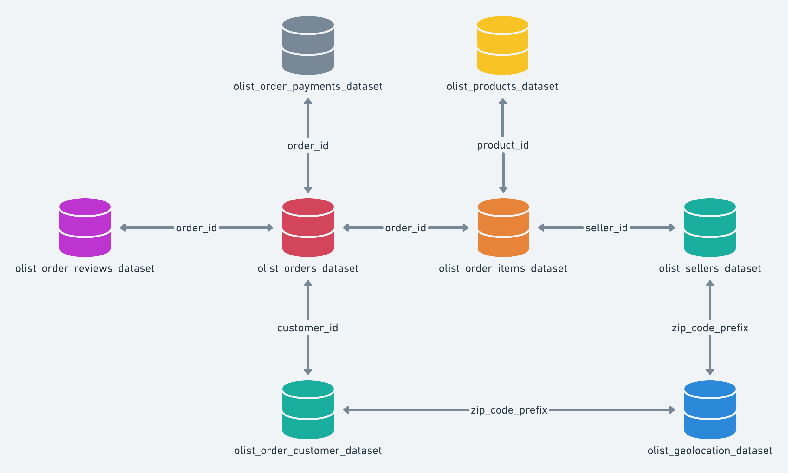
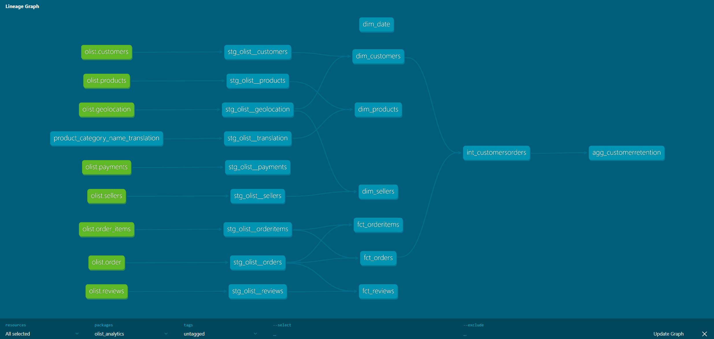

# Olist E-commerce Analytics (dbt)

## One-line summary

A 9-table MySQL model of 90K+ orders, rebuilt in dbt Core + DuckDB as a proper star schema — including fixing a grain error that had inflated customer-retention figures.

*Personal project · 2026 · MySQL, dbt Core, DuckDB, Power BI · Public*

## TL;DR

- Modelled the Olist Brazilian e-commerce dataset (90K+ orders) as a 9-table relational MySQL database and ran end-to-end SQL analysis across payments, delivery, pricing, and reviews.
- Rebuilt the pipeline in dbt Core + DuckDB as a full star schema (facts & dimensions, staging → intermediate → marts).
- The rebuild caught a grain error in the original model that had inflated customer retention to 6% when the correct figure was 3%.

## Context

Olist is a Brazilian e-commerce marketplace that connects small retailers to major sales channels. Their public dataset consists of 9 relational tables covering orders, customers, sellers, products, payments, reviews, and geolocation. I picked this dataset because it intimidated me at first: 99K orders across 9 tables, from a marketplace I knew nothing about. I wanted to see whether I could find sense in foreign data of that size.

I also had the goal of learning how to build informative Power BI reports, how to build dbt layers, and gaining an understanding of how these tools work together in a professional setting.



## The Problem

Going in, I did not have a set of ready questions or points I wanted to analyze. The first goal was to explore the data table by table, understanding each table's shape, content, and place in the schema. The second goal was deciding what to analyze and focus on. I had complete freedom here, and I needed to set boundaries for myself to avoid going off-track or extending the project into a six-month, never-ending learning project.

## My Role & Constraints

I carried out this project in its two phases from start to finish. For the first phase, I chose to use Power BI along with MySQL. I already had a strong base in MySQL and decided to reuse it rather than learn a new system, so I could focus on the data and Power BI.

During the second phase, I rebuilt a transformation and semantic layer using dbt and DuckDB. I wanted to focus on building the semantic layer and understanding dbt. To that effect, I picked DuckDB as it had the lowest learning curve and could be set up and managed easily on my own laptop.

## Approach & Key Decisions

### Phase 1: MySQL + Power BI

**Exploring the data**

I started by exploring the data table by table, gaining an understanding of each table's shape, content, and place in the schema. From this stage, I produced a list of observations, key numbers, and possible insights that could be drawn from each table.

**Narrowing down the analysis scope**

Going completely rogue on a big dataset with no preset list of questions can be tricky. I was aware of my ability to dig deep and spend time on tiny questions that do not carry much value, and of the possibility of looking for an answer the data can't provide due to limitations in the data itself.

To limit my analysis, I performed a statistical exploration where possible, with the goal of finding constraints, issues, and unclear features in the data, and subsequently crossing out unanswerable questions altogether.

An example of an unanswerable question would be: *"How do customers pay for orders above 500 BRL?"* But if the dataset contains a very limited number of orders with a total value above 500 BRL, it isn't possible to draw a conclusion, and the question should not be pursued.

**Final list of questions**

By the end of the exploration stage, I had decided on a set of questions that held my interest:

1. Payment Analysis:
   - Frequency of each payment type
   - Credit card installment distribution vs. order value
   - Payment combinations for split orders
   - Does approval time change with payment method?
2. Products Analysis:
   - Which product categories have the highest demand?
   - Which categories have the highest and lowest review scores?
   - Seasonal price patterns for high-frequency products
3. Customer Behavior Analysis:
   - Customer retention rate and repeat purchase frequency
   - Delivery time vs. review score
   - Does unhappiness drive longer written reviews?

**MySQL to Power BI**

I performed basic cleaning operations inside MySQL: fixing column names, correcting column types and formats (especially date columns), and nulling empty fields. I also stayed inside MySQL during the exploration stages.

When I started the analysis part — answering my questions one by one — I began categorizing them into questions that could be answered directly in Power BI (no prior joining or operations needed in MySQL) and questions that were too complicated to handle directly inside Power BI. My goals here were to do most of the work in MySQL instead of Power BI to keep it documented and clear, and to have a plan for what I was going to do in Power BI before I went there.

For Power BI-native questions, I would write the query and look at the output to make sure it was correct. Where calculations were needed, I used measures and DAX, then replicated the output as a visual inside Power BI. For the complicated questions, I would create a view out of the query and import that view to Power BI. I made sure that imported views contained a column that could be used to connect them to the rest of the tables in Power BI, to avoid having unconnected tables.

### Phase 2: dbt Core + DuckDB

I gained a lot of appreciation for dbt once I started using it. The way the SQL files are written, the documentation, and the ability to trace changes back to their root cause was astounding. A lot of that load was previously done manually in MySQL. I am writing this a few months after finishing that project, and I find that I can understand and remember the decisions I made and the steps I took very easily.

**dbt to DuckDB: Ingestion and Staging**

I configured dbt's connection to DuckDB, ingested the raw tables into a raw schema in DuckDB, then started building the staging layer. The staging layer carried out all the cleaning previously done in MySQL. It also carried out generic testing: unique for PK columns, not null, relationships, accepted values and ranges, as well as composite key uniqueness in the staging layer.

Each raw table got its cleaned, ready-staged model, ready for analysis. Because I had already done this analysis in MySQL in the previous phase, I had an understanding of what I needed to carry out and what cleaning and testing I needed to do.

**Marts**

I did not change the shape or original relations between the tables in the first phase (Figure 1). In this phase, I went one step deeper and built the star schema inside the marts layer, to optimize the data and visualizations inside Power BI. I split the data into fact and dimension tables, where I joined different tables to produce the dimension tables. Each dimension table needed to fully describe its dimension. Products could be described with their categories, and answering a question on the number of products in each category, or sale rates per category and product, would need a product-category join. Customers and sellers are in certain geolocations, and any analysis on the distribution of customers or sellers over Brazil would need a join with the geolocation table. This reasoning derived the shape of the final dimension tables.

I also created an additional date dimension table that spanned the dataset's date ranges. It acted as an anchor for evaluating any time analysis.

It was during this marts stage that I gained a deep understanding of table grains, unlocked a new level of understanding of how joins work, and learned how to correctly perform them to avoid inflating or over-expanding the tables.

The following table details the final dimensions and facts tables:


| Dimensions | Facts |
| :--- | :--- |
| dim_products (products + category translation) | fct_order_items (grain: one line item — the core sales fact) |
| dim_customers (customers + geolocation per zip) | fct_orders (grain: one order) |
| dim_sellers (sellers + geolocation per zip) | fct_reviews (grain: one review per order) |
| dim_date (generated calendar, 2016–2018) | |



### Customer Retention: how dbt caught a grain error

**The original query and what it did:**

To calculate customer retention, I had created a view inside MySQL to join the customers table to the orders table and count the number of times the same customer placed an order using the window function COUNT() OVER(), using each customer's unique ID:

```sql
CREATE VIEW customer_retention AS
SELECT 
    o.order_id, 
    c.customer_unique_id,
    COUNT(customer_unique_id) OVER(PARTITION BY customer_unique_id) as id_repetitions
FROM orders as o
JOIN customers as c
    ON o.customer_id = c.customer_id;
```

Then inside Power BI, I created a measure to calculate customer retention by counting the number of IDs that were repeated more than once and dividing it by the total number of IDs:

```dax
more_than_once = 
DIVIDE(
    CALCULATE(
        COUNTROWS('olist customer_retention'),
        'olist customer_retention'[id_repetitions] > 1
    ),
    COUNTROWS('olist customer_retention'),
    0
)
```

**What went wrong:**

What this failed to do was group the customer IDs before counting them, inflating the count (customer IDs with 5 orders got counted 5 times, 10 orders got counted 10 times, whereas each should have been counted only once). The final reported customer retention was 6%.

**dbt's correction**

Inside dbt, in the aggregate calculation, I grouped the customer IDs before counting them, and the customer retention came out as 3%:

```sql
WITH customer_orders AS (
    SELECT * 
    FROM {{ref('int_customers_orders')}}
),
final AS (
    SELECT 
        customer_unique_id, 
        COUNT(*) as num_of_orders
    FROM customer_orders
    GROUP BY customer_unique_id
)
SELECT * 
FROM final
```

How did dbt help me spot this mistake? It forced me to develop a deeper understanding of table grains to be able to develop the marts layer. I was not aware of the difference in the SQL query as I was writing it, nor was I copying and pasting. I had simply written the new query based on my newly formed understanding of grains. It was only after seeing the difference in the final value that I compared the two and understood the mistake I previously made.

## What the Analysis found

1. Splitting a payment is almost always about combining a voucher with another method. It does not signal financial difficulty. Only 1 order in 99K+ was split across two payment methods without a voucher.

2. Order approval time varies significantly by payment type, with boleto payments taking the longest.

3. Unhappy customers vent more in their reviews, with 1-star worded reviews being on average twice as long as 5-star worded reviews.

4. Delivery status strongly drives satisfaction levels, with late deliveries scoring lower overall review scores versus early and on-time deliveries.

5. A weak Q1 price dip pattern was observed across continuously purchased products, consistent across sellers, suggesting a market-level trend rather than individual seller behavior.

6. All product categories have very close overall review scores, pointing to a null relationship between categories and satisfaction levels.

## What Changed

Phase 2 (dbt + DuckDB) introduced a lot of structure and reliability to the data flow and transformation layer. It also eased the relationships in Power BI, because dbt forced me to build those relationships manually in the mart layer instead of relying on the shape of the source schema.

The grain error is the clearest example: the original MySQL model reported 6% customer retention; the dbt rebuild reported 3%, and the difference was a real modeling mistake, not a data change.

## What I’d do differently

1. Borrow the dbt structure from the start, even if the first version runs on MySQL. By the dbt structure, I mean staging, testing, documentation, and lineage flow. This structure would help catch and reduce errors more efficiently.

2. Cross-check calculated Power BI measures against queries in SQL as a double-check step. A five-minute sanity check on the number of distinct unique customer IDs could have caught the retention mistake.

## Links

- [View the original MySQL analysis on Github](https://github.com/NohaKhaled01/Olist_DataSet)
- [View the dbt rebuild on Github](https://github.com/NohaKhaled01/Olist_Dataset-dbtProject)
